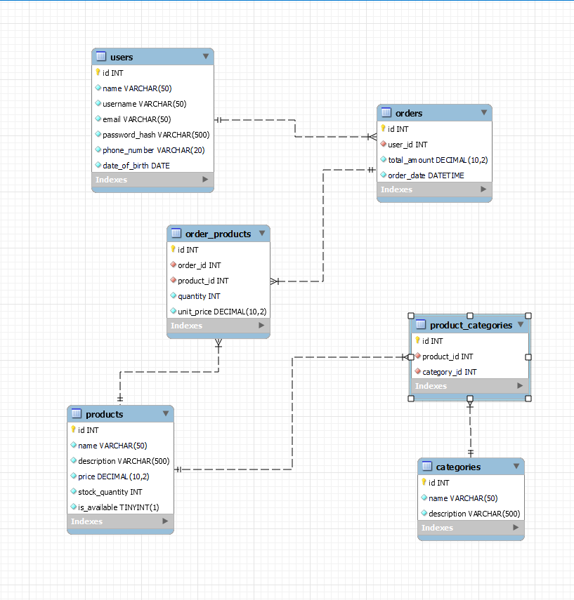

# IT-2001-Web-Application

## Gym Club – Supplement Shop

Gym Club is a web application for a gym that sells fitness supplements (whey protein, creatine, omega 3). Users can register, log in, browse products, add them to a cart, place orders and view their profile and order history.

## Project Structure

```
backend/
  config/       # configuration (excluded from Git)
  dao/         
  logs/         #  (excluded from Git)
  middleware/
  routes/
  services/
frontend/
  assets/       # images, video, static JSON data
  css/
  js/           # app.js (page logic), router.js (SPA routing)
  views/        # HTML templates loaded by the router
  index.html
```

## Pages (SPA)

Navigation is hash-based (`#/route`); views are loaded into `index.html` without full page reloads.

- `#/landing` – home page (gallery, FAQ, weather)
- `#/products` – product list
- `#/whey`, `#/creatine`, `#/omega3` – product detail pages
- `#/cart` – shopping cart
- `#/signup` – registration
- `#/signin` – login
- `#/profile` – user profile and order history

## Database (Draft ERD)



Entities:

- **users** – id, name, username, email, password_hash, phone_number, date_of_birth
- **products** – id, name, description, price, stock_quantity, is_available
- **categories** – id, name, description
- **product_categories** – product_id, category_id (products ↔ categories, many-to-many)
- **orders** – id, user_id, total_amount, order_date (user has many orders)
- **order_products** – order_id, product_id, quantity, unit_price (orders ↔ products, many-to-many)
