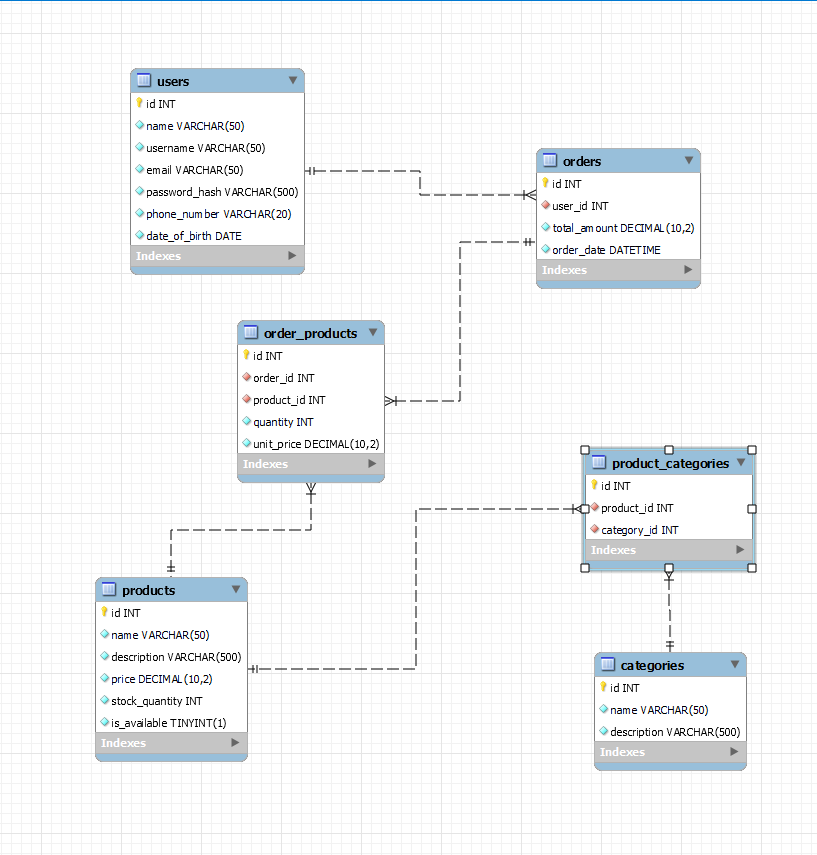

# IT-2001-Web-Application

## Gym Club – Supplement Shop

Gym Club is a web application for a gym that sells fitness supplements (whey protein, creatine, omega 3). Users can register, log in, browse products, add them to a cart, place orders and view their profile and order history.

## Project Structure

```
backend/
  config/
    config.example.php   # settings template 
    config.php           # (excluded from Git)
  logs/                  # (excluded from Git)
  middleware/
  public/v1/docs/        # Swagger UI + OpenAPI documentation
  rest/
    dao/                 # data access (PDO)
    routes/              # FlightPHP routes
    services/            # business logic
  utils/                 # exceptions, Validator, Roles
  vendor/                # Composer packages (excluded from Git)
  composer.json
  index.php              # API entry point
database/
  gym_web_app.sql        # schema + sample data
frontend/
  assets/       # images, video, static JSON data
  css/
  js/           # app.js (page logic), router.js (SPA routing)
  views/        # HTML templates loaded by the router
  index.html
server.php      # router for PHP's built-in web server
```

## Pages (SPA)

Navigation is hash-based (`#/route`); views are loaded into `index.html` without full page reloads.

- `#/landing` – home page (gallery, FAQ, weather)
- `#/products` – product list
- `#/whey`, `#/creatine`, `#/omega3` – product detail pages
- `#/cart` – shopping cart
- `#/signup` – registration
- `#/signin` – login
- `#/profile` – user profile and order history

## Database (Draft ERD)



MySQL database `gym_web_app`.

- **users** 
- **products** 
- **categories** 
- **product_categories**
- **orders**
- **order_products** 

## DAO Layer

The DAO layer is in `backend/rest/dao` and uses PDO with prepared statements.

- **BaseDao** – one shared PDO connection and the generic methods `get_all()`, `get_by_id()`, `count_all()`, `add()`, `update()`, `delete()` and transactions. 
- **UserDao** – `get_by_email()`; `get_all()` and `get_by_id()` never return the password hash
- **ProductDao** – `get_by_category()`, `change_stock()`
- **CategoryDao** – `count_products_per_category()`
- **ProductCategoryDao**
- **OrderDao** – `get_by_user()`
- **OrderProductDao** – `get_by_order()`

## Business Logic

One service per entity in `backend/rest/services`. Services validate the input, check the business rules and are the only layer that calls the DAOs. A broken rule throws an exception with an HTTP status (400, 401, 403, 404, 503).

- **UserService** – unique email and username, strong password stored only as a bcrypt hash; a user with orders cannot be deleted
- **CategoryService** – unique name; a category with products cannot be deleted
- **ProductService** – price and stock cannot be negative; a product in orders cannot be deleted
- **ProductCategoryService** – a product can be in a category only once
- **OrderService** – the total is always calculated by the server; `place_order()` checks the stock and saves the order in one transaction
- **OrderProductService** – the price comes from the product; stock and order total change together in one transaction

## REST API

FlightPHP routes in `backend/rest/routes`, base URL `http://localhost:8000/backend`. Every entity has full CRUD (`GET`, `POST`, `PUT`, `DELETE`):

`/users` · `/categories` · `/products` · `/product-categories` · `/orders` · `/order-products`

Extra endpoints: `GET /users/{id}/orders`, `GET /categories/{id}/products`, `GET /categories/stats`, `GET /orders/{id}/products`, `POST /orders/place`.

Errors are returned as JSON: `{"status": 404, "error": "Product not found."}`.

## API Documentation

OpenAPI documentation with Swagger UI: `http://localhost:8000/backend/public/v1/docs/`

## External API

`GET /weather/current?city=Sarajevo` returns the current weather from **OpenWeatherMap**. The landing page uses it for the "Check Your Weather" button. The API key is kept in `backend/config/config.php`. Timeouts and errors of the external service return `503`, an unknown city returns `404`.

## Setup

1. Start MySQL in XAMPP (PHP 8.2 or newer) and import `database/gym_web_app.sql`.
2. Copy `backend/config/config.example.php` to `backend/config/config.php` and set the database settings and your OpenWeatherMap API key.
3. Install the packages in the `backend` folder: `composer install`
4. Start the server in the project folder: `php -S localhost:8000 server.php`
5. Open the app at `http://localhost:8000/frontend/` and the API docs at `http://localhost:8000/backend/public/v1/docs/`